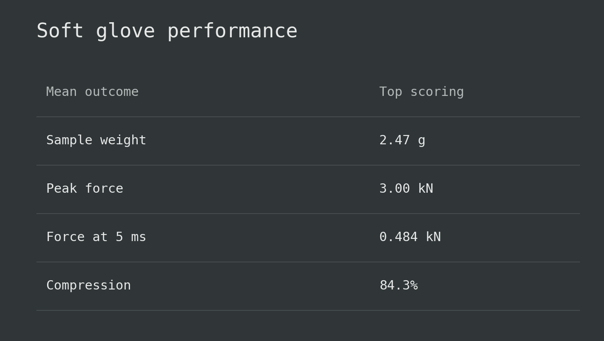
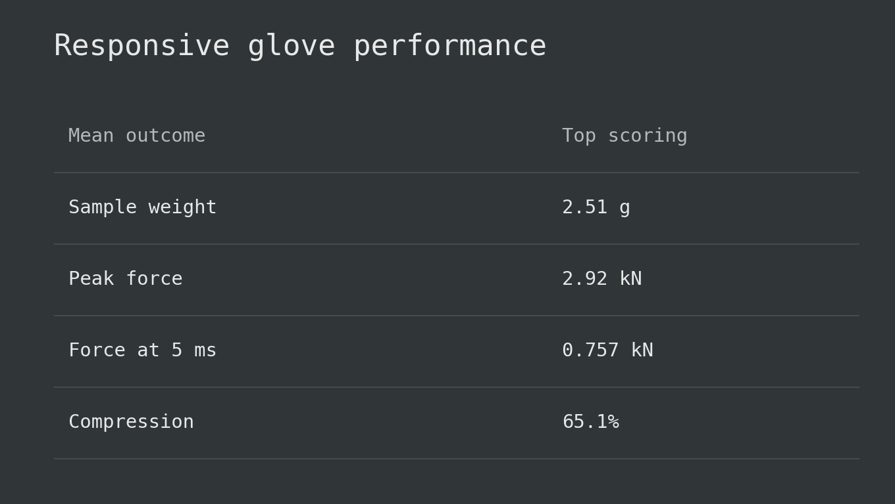
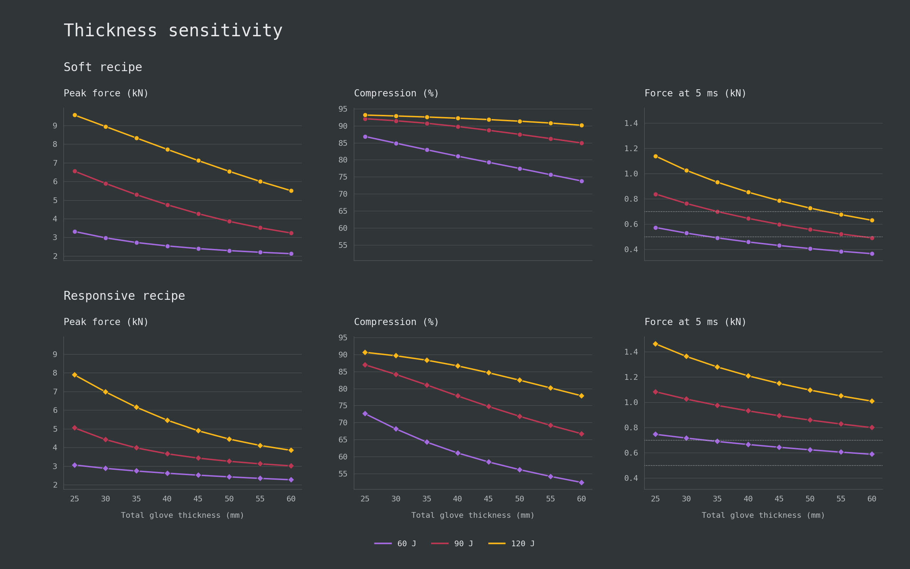

# Analysis

## 1. Simulation run

- The design question is how to build a soft glove and a responsive glove that both
  limit peak force, within the same thickness and sample-weight range. The
  comparison follows material families, weight efficiency, then specific recipes.
- Compared 2,206,920 complete, 50 mm stacks in
  [the dataset](../data/simulations_2026-10-24_5ms.csv).
- Each stack uses four distinct grades from the 59-grade
  [analytical catalog](../data/analytical-foams2.csv).
- Baseline impact: 2.597 kg at 7.7 m/s, against 50 mm CutFoam EVA75.
  Dome geometry, hand spring, and material assumptions are unchanged.
- Equivalent material-thickness combinations are counted once. The model
  identifies useful materials and amounts; swapping their order gives the same
  result. The layer labels below describe the tested construction, so a winning
  "outer" grade is evidence for including that foam, not proof of its placement.

HR means high-resilience polyurethane foam; PU below means conventional polyurethane.

| Layer | Materials | Grades available | Thickness |
| --- | --- | --- | --- |
| Outer | PU, HR, or latex | 46 | 5, 10, 15, 20, or 25 mm |
| Main cushion | PU, HR, EVA, or latex | 59 | Remaining thickness, 15-39 mm |
| Support | Aortha A25/A35/A50; CutFoam EVA75/EVA240; Evazote EV30/EV50/VA35; Minicel T380/T600 | 10 | 3, 4, or 5 mm |
| Comfort | Foam Factory Super Soft PU or FoamOnline Very Soft HR | 2 | 3, 4, or 5 mm |

## 2. Family characteristics

- **Main cushion:** HR is the strongest starting point for the core. It builds
  resistance earlier than conventional PU while limiting peak force and
  compression. EVA offers some of that benefit at greater average weight.
  Prioritize cushioning through the whole impact over ease of initial collapse.
- **Outer:** a compliant PU component can soften an HR core's early response;
  another HR component keeps the stack firmer. Latex consumes more weight
  without matching HR's mean peak-force performance. These family comparisons
  include changes elsewhere in the stack.
- **Support:** the gain from increasing backing firmness has diminishing returns.
  Moving from EVA75 to A35 improves mean peak force; the further move to A50
  adds about 10% sample weight for only 0.2% lower peak force. The design priority
  is enough backing for the construction, with extra density justified by a
  useful benefit. The simulation does not measure the backing's structural job.
- **Comfort:** treat this as a final adjustment. Its effects are small in the
  broad comparison. A consistent grade choice within a response class can help
  meet that band without implying that it drives the cushioning performance.

Layer summaries: [outer](../figures/table1-outer.csv),
[main cushion](../figures/table1-main-cushion.csv),
[support](../figures/table1-support.csv), [comfort](../figures/table1-comfort.csv).

## 3. Responsiveness

- Measure the contact force 5 milliseconds after the punch first touches the
  target. A lower force means a gentler start to contact; a higher force means
  the glove develops firm resistance earlier.
- Classify each stack using that force:

| Response | Force at 5 ms | Meaning |
| --- | --- | --- |
| Soft | Below 0.50 kN | Gentle early contact |
| Neutral | 0.50 to below 0.70 kN | Intermediate early resistance |
| Responsive | 0.70 kN or higher | Firm early contact |

- These are fixed design bands for this experiment, applied to every foam
  family and sample weight. They describe early contact, not rebound.

- Conventional PU readily supplies a soft start, but its main-cushion stacks
  do not reach the responsive band in this experiment. HR offers enough variation
  to tune between all three responses, making it a useful basis for distinct styles.
- Early force alone rewards either easy collapse or stiffness. The response
  band defines the intended feel; peak force and compression decide which
  stacks sustain useful cushioning through the rest of the punch.

## 4. Performance by sample weight

- Each frontier follows the lowest observed outcome within its 0.5 g bucket. Bands
  show the five outcome quintiles in that bucket.
- **More weight does not keep buying better protection.** The best peak-force
  region is around 1.5-3 g; the frontier worsens toward the heavy end. At fixed
  50 mm, added weight means a denser mix while padding thickness stays the same.
  Choose the material combination before spending more weight on density.
- The lightest stacks also perform poorly: they combine gentle early contact
  with high compression and high peak force. Low weight is useful when the
  remaining material can control the punch, not merely yield to it.

- **Compression is a separate design tradeoff.** Its frontier does not follow
  the peak-force frontier. A stiff stack can retain thickness while transmitting
  too much force. Favor compression reserve among stacks that already meet
  the peak-force and response requirements.

- **Both styles are available at similar weights.** Around the recipe weight,
  early forces span soft through responsive; material choice provides that
  freedom. The frontier follows the lowest early force in each weight bucket.

- Quintiles are relative to nearby weights. The recipe markers show the
  balance of protection, compression reserve, and early response in Section 5;
  neither recipe needs to win any one metric alone.

## 5. Soft and responsive recipes

Both recipes use 50 mm stacks weighing 2.50 +/- 0.05 g, with peak force
at or below 3.026 kN. Tables summarize the top-scoring groups; response curves
show one recipe from each group. [Scoring details](../figures/table4-scoring.json).

### Soft: compliant PU with a soft HR core

- Build around FoamOnline HR Soft, with a limited amount of conventional PU
  to provide early give. All four top-scoring stacks converge on 33-34 mm of
  that HR core, 10 mm conventional PU, and a thin Super Soft PU comfort layer.
- Foam Factory Lux-HQ, FoamOnline Lux Firm, and CutFoam H35-200 are the PU
  candidates. Their modeled impact pressure at 25% compression is only
  23-30 kPa, versus 164 kPa for the HR Soft core. A foam sold as "Firm" can
  therefore supply the compliant part of this combination. Supplier grade
  names do not provide a common firmness scale across families.
- A35, A50, and EVA240 all qualify as thin supports. The core and compliant
  PU portion identify this construction more clearly than any one backing grade.

Response recipe, sample weight 2.452 g:

| Layer | Foam | Thickness |
| --- | --- | --- |
| Outer | Foam Factory Lux-HQ | 10 mm |
| Main cushion | FoamOnline HR Soft | 34 mm |
| Support | CutFoam EVA240 | 3 mm |
| Comfort | Foam Factory Super Soft | 3 mm |

- The thin PU components use most of their central thickness early, while the
  HR core retains much of its travel. Over the full punch, the core supplies
  most of the glove's compression work. The cost of the gentle start is that
  part of the padding has already yielded before the larger forces develop.

### Responsive: firmer HR cushioning throughout

- Build around CutFoam HR36-160 or FoamOnline HR Medium Soft/Medium, paired
  with another HR component. These main cushions supply a moderate impact
  firmness, around 229-279 kPa at 25% compression. The firmer HR grades appear
  mainly in smaller amounts, preserving a substantial moderate-firmness core.
- Density alone would miss this distinction. The soft and medium FoamOnline
  HR grades have the same catalog density, so core firmness can change without
  a density penalty. The HR components retain more early travel than the PU
  portions of the soft recipe.
- EVA240 is the leading support candidate across the top tier; A35 and A50
  remain alternatives. Very Soft HR comfort is consistently selected. These
  choices belong to the complete construction; their individual contributions
  have not been isolated by this ranking.

Response recipe, sample weight 2.538 g:

| Layer | Foam | Thickness |
| --- | --- | --- |
| Outer | CutFoam HR40-230 | 5 mm |
| Main cushion | CutFoam HR36-160 | 38 mm |
| Support | Aortha EVA A50 | 4 mm |
| Comfort | FoamOnline HR Very Soft | 3 mm |

- Compared with the soft recipe, more of the early compression occurs in the
  target and less in the glove. The striking mass slows earlier while more
  glove travel remains. The thick HR core still supplies most of the glove's
  compression work over the punch.

### Design takeaway

- **Tune early give around a capable core.** Both gloves take on similar
  amounts of energy during loading and reach similar peak force. The soft
  construction uses more compression to do so. Total work alone would conceal
  the difference in how they handle the punch.
- **Softness costs compression reserve here.** About 8 mm remains in the soft
  recipe versus 17 mm in the responsive recipe. Section 7 tests how that difference
  affects performance under stronger impacts. Remaining thickness is not a
  measurement of how much additional punch energy either recipe can handle.
- **Dense backing in these recipes does not overturn its diminishing returns.**
  A suitable lighter stack can be excluded simply for falling below 2.45 g.
  This comparison selects at a specified weight. It does not test the benefit
  of saving backing weight and spending it on extra cushion thickness.
- **Treat the construction as the stronger finding than the exact winner.**
  The tested score weights change some grades and thicknesses while retaining
  the soft PU/HR combination and the responsive HR combination. Those patterns are
  a more useful starting point than insisting on one exact grade in every layer.

## 6. Protection and early response

- **Early firmness does not require a higher peak force.** The low-peak-force
  region contains both soft and responsive responses. Moving between them can change
  early contact without paying a peak-force penalty, as the selected pair shows.
- **There is still a limit to pursuing either extreme.** Moving toward the
  highest early forces eventually gives up peak-force performance. At the
  other extreme, much of the very soft population has poor peak-force results.
  Choose a response range, then improve protection within it.
- **Neutral is the broadest compromise among qualifying stacks.** It offers
  more material choices within the weight and peak-force limits. Distinct soft
  and responsive products deliberately narrow that freedom, especially for soft.
- The key material assumption is HR's increase in resistance during fast loading,
  taken from a borrowed family curve ([MODEL.md](MODEL.md#slow-tests-and-fast-impacts)).
  Checking that behavior in the shortlisted grades matters more than a small
  score difference between otherwise similar stacks.

## 7. Recipe sensitivity to thickness and punch energy

- Keep the two recipes from Section 5 and scale every layer proportionally:
  25-60 mm total thickness in 5 mm steps. Test each at 60-120 J in 10 J steps.
  Mass stays at 2.597 kg; energy changes through speed. Target, hand spring and
  foam curves stay fixed. The original comparison was at about 77 J and 50 mm.

### Similar peak force can hide different responses to stronger punches

- **The responsive recipe's reserve becomes useful as energy rises.** At 50 mm,
  the soft recipe has slightly lower peak force at 60 J, but reaches 6.54 kN at
  120 J against 4.45 kN for responsive. Responsive has lower peak force at every
  tested thickness from 90 J onward. The near-equal peaks in Section 5 describe
  one impact; they conceal a substantial difference over the wider range.
- **A flattening compression curve can signal a worsening force response.**
  In the model, each impact ends when compression work in the glove, target and
  hand spring equals the incoming energy. As the foams approach the steep parts
  of their curves, a small additional compression requires a large pressure
  increase. At 50 mm, the soft recipe's last 10 J adds about 2.6 times as much
  peak force as its first 10 J. Compression approaching a plateau is therefore
  not evidence that the glove is handling stronger punches comfortably.
- **Early give and useful stopping travel are different.** The compliant PU
  parts of the soft recipe have already used most of their central thickness
  at 60 J. Its HR core must then work farther into high compression as energy
  rises. Between 60 and 120 J, the responsive core takes on about 34 J of extra
  compression work, versus 20 J for the soft core; more of the soft construction's
  added stopping work goes into the target and hand spring. This explains why
  gentle early contact can coexist with a much larger final force.

### What extra thickness buys

- **Adding thickness is different from adding density.** Section 4 kept thickness
  fixed, so heavier stacks did not gain more travel. Here, a thicker layer can
  shorten farther and take on more work at the same material strain. Every
  tested increase in thickness lowers peak force and compression percentage
  for both recipes. The weight is buying additional cushioning volume.
- **The benefit is not proportional.** At 120 J, the responsive recipe gains
  much more from 25 to 30 mm than from 55 to 60 mm. Nor does keeping energy per
  millimeter fixed preserve performance: doubling both thickness and energy
  from 30 mm / 60 J to 60 mm / 120 J raises soft peak force from 2.97 to 5.50 kN.
  Only the glove has been enlarged. The target and hand spring also helped stop
  the original punch, but have not been scaled along with the glove. Contact
  geometry is unchanged too, so work taken on by the whole system does not
  scale in proportion to glove thickness.
- **Uniform scaling keeps the material proportions.** It enlarges the
  compliant parts along with the core and backing. More thickness helps the
  soft construction, but even at 60 mm it reaches about 90% compression at
  120 J. If 60 mm is the limit, further improvement needs a change in material
  proportions or response curves. This test does not establish which change
  would preserve the gentle start while improving late resistance.

### Response belongs to an impact condition

- **The soft recipe stays relatively softer, but does not stay in the soft band.**
  It has lower force at 5 ms at every matched thickness and energy. At 50 mm,
  however, it changes from soft at 60-70 J to neutral at 80-110 J and responsive
  at 120 J. At 60 mm it stays soft through the tested 90 J point, but no tested
  thickness keeps it soft at 100-120 J. Thickness extends the range over which
  the intended response is delivered; it does not make that response permanent.
- **The foam itself has not become a different material.** Each grade keeps
  the same fast-loading curve. A faster punch progresses farther through the
  loading response by 5 ms, changing the force sampled there. Peak force and
  compression depend on starting energy in this model; force at 5 ms also
  depends on how that energy is supplied through mass and speed. The bands in
  Section 3 therefore need a specified punch condition when comparing products.

### What this changes about the design direction

- **The soft design needs useful travel after the gentle start.** Its next
  design question is how to retain early give without spending so much of the
  available thickness before larger loads develop. The responsive construction
  is the stronger of these two starting points at higher energy; that does not
  establish an unavoidable penalty for every soft construction. The original
  score identifies a recipe at one condition. Its response to stronger punches
  is a separate design requirement that the three baseline scores cannot settle.
- **The high-energy separation depends on the assumed high-compression curves.**
  At 50 mm / 120 J, both cores extend beyond their reference-fit range. The
  [tail model](MODEL.md#7-how-we-handle-the-high-compression-tail) controls how
  sharply resistance rises there. These results identify the behavior that
  needs checking in the actual foams; they do not establish a measured
  bottoming-out threshold.

Full-grid figures: [peak force](../figures/figure6-peak_force_n.png) and
[compression](../figures/figure6-maximum_glove_compression_percent.png).
[Saved runs and outcomes](../data/table6-sensitivity/results.csv),
[numerical checks](../data/table6-sensitivity/validation.json).
