# Introduction

Boxing gloves are usually identified by weight, closure, colour, and price. These details say little about how well a glove controls impact or how it feels in use. Gloves with the same weight and similar appearance can transmit different forces and feel markedly different because their padding is constructed differently.

Manufacturers rarely disclose that construction in useful detail. Product descriptions may name broad materials such as polyurethane, latex, or EVA, but usually omit the specific grades, layer thicknesses, and compression behaviour. Glove weight alone therefore cannot explain how the padding responds as force increases.

Terms such as "pillowy" and "poppy" describe glove feel, but their meanings vary. "Pillowy" commonly suggests a soft initial response. "Poppy" may describe firm feedback, quick rebound, or the sound of a punch on the bag. Neither term explains how force develops through the padding or provides a shared basis for comparing gloves.

Knowing the padding construction would still leave a material-data gap. Commercial foam listings usually provide density and one or two firmness values, often measured using different test methods. These isolated values do not show how resistance develops across the full compression range or under rapid loading. Predicting a complete padding stack therefore requires estimating the response between and beyond the available measurements.

This study connects these incomplete material data with disclosed stack construction through simulation. The model combines estimated compression curves for specific foam grades with layer thickness, glove geometry, and impact conditions. It compares how candidate constructions build force, use their compression travel, distribute work, and fit within thickness and weight limits before physical prototypes are made.

The sections that follow define the mechanical role of padding, identify candidate foam families and the available material data, review the evidence and remaining design gap, construct the mathematical model and estimated foam-response curves, compare stack architectures in simulation, and draw practical conclusions for material and stack selection.

## Interactive simulator

The [interactive simulator](https://foam.believe.cv/) provides a visual interface for the browser implementation. It can be used to vary the impact condition, foam material, and thickness of each glove layer, and to inspect the resulting force, compression, timing, and weight alongside the full impact traces.

# Mechanical role of glove padding

Foam increases the distance and time over which the fist decelerates after contact. As it compresses, it pushes back. A useful layer gives enough at first to avoid an abrupt initial load, then develops support as compression increases. Foam that is too soft or too thin can exhaust its useful travel and become suddenly hard to compress, while foam that is too firm can build force too quickly from the start.

Combining layers allows the response to be shaped through the impact. The compression curve of each foam records how its resistance changes under a defined test, and its thickness determines how much physical shortening a given strain provides. Understanding the assembled glove therefore requires connecting the curve and thickness of every layer to the stack's response during impact.

That connection needs three kinds of evidence: compression tests for the materials, impact tests for the complete glove, and realistic impact conditions for the boxer, hand, and target. Together they can show whether a stack uses its travel effectively, develops resistance progressively, and delays bottoming.

# Candidate foam materials and data

Foam-family names indicate broad tendencies, but a grade's density, firmness, resilience, and full compression curve determine its response.

Conventional flexible polyurethane, or PU, ranges from soft and yielding to firm and supportive. Softer grades can add initial compliance and comfort, while firmer grades can provide transition support deeper in the stack. High-resilience PU, or HR PU, is formulated for greater resilience and faster recovery. Its stronger rebound can produce a livelier feel, and its support through compression can make it useful as a middle or backing layer.

Latex foam is elastic, resilient, and relatively dense. Its rebound is commonly perceived as springy or responsive, but its mass and sustained resistance affect where and how much can be used. EVA is a closed-cell foam available across a wide range of densities and firmnesses. It can provide firm early resistance and structural support in a thin layer, while denser or firmer grades can feel crisp and direct.

# Evidence base and design gap

## Commercial data and limitations

Commercial foam listings usually report density and one or more firmness values. Complete loading and unloading curves for specific grades are rare, as are measurements of loading-rate effects, thickness effects, fatigue, and variation among samples or batches. Suppliers also use different test methods, specimen dimensions, units, and compression levels, which limits direct comparison.

Finished-glove specifications usually omit foam grades, layer thicknesses, and stack order. Impact studies use different strikers, targets, energies, and reported measures, and few report force-time history, deformation, compression, and repeated-impact behaviour together. Published specifications therefore cannot provide a full mechanical description of a commercial foam or finished glove.

## Standards and competition rules

Competition rules mainly determine whether a glove may be used. They specify matters such as weight, padding allowance, materials, dimensions, thumb attachment, closure, condition, and approval, but do not define padding compression, recovery, or impact feel. The [World Boxing Competition Rules](https://worldboxing.org/wp-content/uploads/2024/11/World-Boxing-Competition-Rules-Nov-2024-Approved.pdf) are one example.

EN 13277-7 asks whether a hand protector keeps transmitted peak force below a stated limit in a prescribed drop test. A 2.5 kg striker with an 80 mm domed face and 100 mm radius is dropped onto the glove, which rests on a rigid 90 mm half-cylinder with a load cell beneath its central anvil. Class A and B protectors receive 3 J impacts, while the increased-protection zone of Class B also receives 10 J impacts; the stated peak-force limit is 2 kN. These details come from the [SATRA summary of EN 13277](https://www.satra.com/spotlight/article.php?id=423). The standard concerns protection of the wearer's hand and expressly excludes performance for the opponent, as stated in the [EN 13277-7:2009 preview](https://cdn.standards.iteh.ai/samples/26354/0e49f762fd014431939bb6888166baf2/SIST-EN-13277-7-2009.pdf).

The standard provides a repeatable pass-or-fail screen based on peak force. Full force-time and compression histories can distinguish gloves that receive the same result.

## Relevant impact and material research

### Finished-glove impact tests

Glove weight is an unreliable predictor of impact response. [Girodet et al. (2009)](https://doi.org/10.1080/10255840903080885) tested nine 10, 12, and 14 oz gloves at 3, 10, and 20 J. Gloves of the same weight produced different peak forces, and the differences grew at higher energy.

The target can change both the measured response and the comparison between gloves. [Perkins et al. (2018)](https://doi.org/10.4236/wjet.2018.63037) dropped gloves fitted to a mechanical fist onto a force plate covered with either 25 or 50 mm of EVA75. Target thickness changed peak force, loading rate, contact time, and relative glove performance. Their force-time curves retained information that a peak-force limit would discard.

Compression and wear add further distinctions. [Chadli et al. (2018)](https://doi.org/10.1016/j.measurement.2018.07.036) compared new and worn gloves at several impact energies using whole-glove compression, energy or acceleration attenuation, and peak force. [Amauger (2022), chapter 7](https://theses.hal.science/tel-04105395) placed a 1.3 kg steel sphere inside a glove, dropped it onto a load cell, and filmed the deformation, allowing force and deformation to calibrate a simplified fist-glove model. Differences in striker, glove mounting, target, impact energy, and recorded measures prevent direct comparison among these rigs.

### Foam compression studies

[Alzoubi, Al-Hallaj, and Abu-Ayyad (2014)](https://pure.psu.edu/en/publications/modeling-of-compression-curves-of-flexible-polyurethane-foam-with/) fitted the same compression model to HR foam, latex, and four flexible PU foams. Each foam had different parameters governing how resistance developed through compression, providing the basis for treating the curve of each grade as a material profile.

[Wu et al. (2023)](https://doi.org/10.3390/polym15234514) fitted a rate-dependent curve to one 35 kg/m³ closed-cell EVA foam. Its shape provides a starting point for estimating the EVA grades considered here, though the estimates remain limited by the number and quality of supplier compression points. [Chen et al. (2024)](https://doi.org/10.3390/polym16010034) further showed that EVA response changes with density and loading rate.

### Human-punch studies

Human studies provide plausible ranges for effective punch mass and hand speed. [Walilko et al. (2005)](https://pubmed.ncbi.nlm.nih.gov/16183766/) and [Adamec et al. (2021)](https://pubmed.ncbi.nlm.nih.gov/33057792/) report these quantities under controlled conditions, although each measurement combines the boxer, hand and wrist, glove, target, and sensors.

Existing studies provide methods for measuring glove response and describing foam compression, but they do not predict how a disclosed set of foam materials and thicknesses will behave together during impact. We developed this model to connect material compression data, stack construction, impact conditions, and glove geometry. It allows candidate stacks to be compared mechanically before physical prototypes are built.

# Mathematical model

## Model setup and scope

Each comparison specifies the punch mass and speed, dome geometry, hand-spring stiffness, and the thickness and compression curve of every glove and target layer. The model follows loading from first contact to maximum compression, calculating force and tracking how movement and work are divided among the glove, target, and hand spring. The punch, dome, target, and hand spring remain fixed while the foam stack changes.

### Mechanical setup

A punch presses the glove foam into a fixed plate covered with foam. The punch travels horizontally, so gravity is ignored, and it receives no further push after first contact. Its initial state is described by speed and striking mass, the term used in the research literature for the effective mass contributing to the impact.

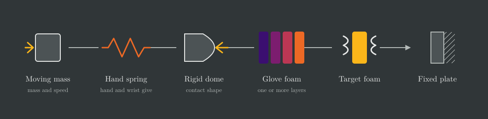

### Why use a rigid dome

The dome represents the rounded front of the fist inside the glove. Its centre touches first, and contact spreads outward as it presses farther into the foam. Because the dome remains rigid, every stack receives the same growing contact area even though compression varies between the centre and edge.

This representation omits individual knuckles, uneven fist shapes, local hand deformation, tilt, rotation, and off-centre contact. A separate hand spring represents overall hand and wrist give without reproducing those local effects.

### Basis for the setup

The foam-covered plate follows the broad arrangement used by [Perkins et al. (2018)](https://doi.org/10.4236/wjet.2018.63037), and the dome dimensions come from the [SATRA summary of EN 13277](https://www.satra.com/spotlight/article.php?id=423). Punch mass and speed are based on [Walilko et al. (2005)](https://pubmed.ncbi.nlm.nih.gov/16183766/) and [Adamec et al. (2021)](https://pubmed.ncbi.nlm.nih.gov/33057792/). The hand spring is a model assumption.

## Construction of foam response curves

Supplier data usually contain only one or two compression values, while the impact calculation needs pressure at every compression level it reaches. The available supplier measurements are converted to a common pressure-versus-strain scale, then published family curves supply the missing shape. This creates a consistent basis for comparison, but the resulting curves remain estimates until the selected materials are tested under the same conditions.

The family shapes come from [Alzoubi et al.](https://oiccpress.com/jsm/article/download/12454/14012/38722) for PU and latex and [Wu et al.](https://doi.org/10.3390/polym15234514) for EVA. PU and latex indentation loads are converted to average pressure; EVA sources already report compression pressure, so the underlying tests remain different. One fixed loading curve represents each foam throughout the brief impact.

## Calculation sequence

The calculation begins with the punch, dome, foam, target, and hand-spring inputs. It advances the dome a small distance toward the plate, uses the dome shape to find the contact region and required local shortening, and obtains local pressure from the foam curves. Integrating pressure over the contact area gives total force. That force determines hand-spring compression and total striker movement, after which the model calculates compression work, remaining speed, and elapsed time. The sequence continues until the striker stops.

## Equations and interpretation

### The incoming punch

Let $m$ be striking mass in kg and $v_0$ be speed at first contact in m/s. They set the starting kinetic energy $E_0$, in J:

$$
E_0=\frac{1}{2}mv_0^2
$$

Mass changes energy proportionally, while speed is squared, so doubling speed gives four times the starting energy. The foam, target, and hand spring must take on this energy as compression work before the striker can stop.

### Foam response

Compression strain $\varepsilon$ is the fraction of a foam's starting thickness that has been compressed. Its loading curve $\sigma$ gives pressure $p$, in Pa, at that strain:

$$
p=\sigma(\varepsilon)
$$

A steep part of the curve means that a small additional compression requires a large pressure increase. Every glove layer and the target have their own curve, and the calculation also uses each relationship in reverse to find strain at a given pressure.

### Dome contact

The dome is circularly symmetric. Radial distance $r$, in m, is measured from its centre. The spherical curvature radius is $R$, in m, and the face ends at footprint radius $a$, in m, where $0<a<R$. Central advance into the glove and target is $q$, in m.

At radius $r$, the dome surface begins a distance $b(r)$ behind its tip:

$$
b(r)=R-\sqrt{R^2-r^2},\qquad 0\leq r\leq a
$$

The gap is zero at the centre and largest at the face edge, giving the required local stack shortening $c(r)$, in m:

$$
c(r)=\max\left[0,q-b(r)\right]
$$

A location carries no load until $q$ exceeds its gap $b(r)$. Further advance compresses the centre more deeply and brings more of the dome into contact. The circular contact region $A(q)$ is limited to $0\leq r\leq a$ where $q>b(r)$, and its area cannot exceed $\pi a^2$. Once $q=b(a)$, the entire face is in contact and subsequent movement increases compression without enlarging the footprint.

### How the layers share local compression

Index $i$ covers every glove layer and the target. Layer $i$ has starting thickness $h_i$, in m. At a given radius all layers carry the same local pressure $p(r)$, but each responds according to its own inverse compression curve $\varepsilon_i[p(r)]$. Their shortenings must add to the shortening imposed by the dome:

$$
c(r)=\sum_i h_i\varepsilon_i\left[p(r)\right]
$$

The model solves this equation for $p(r)$ at every radius. Softer layers take more of the required shortening and firmer layers take less. Because the equation contains no positional effect, reversing the layer order does not change the result when materials and thicknesses stay the same.

### From local pressure to total force

Total force $F$, in N, is the integral of local pressure over the contact area:

$$
F(q)=\int_{A(q)}p(r)~\mathrm{d}A
=2\pi\int_0^a p(r)r~\mathrm{d}r
$$

Here, $\mathrm{d}A$ is an element of contact area and $p(r)~\mathrm{d}A$ is its force contribution. The radial form sums circular rings of area $2\pi r~\mathrm{d}r$ in the plane of the target; pressure is zero where contact has not begun. Force can rise through increasing pressure, a growing contact area, or both.

### Hand and wrist give

Hand-spring stiffness $k_h$, in N/m, is an input. The linear spring carries total contact force $F$, giving compression $q^{\mathrm{HAND}}$, in m:

$$
q^{\mathrm{HAND}}=\frac{F}{k_h}
$$

At the same force, a stiffer spring moves less. The work required to compress the spring is stored as spring energy $U_h$, in J:

$$
U_h=\frac{1}{2}Fq^{\mathrm{HAND}}
$$

As the foam becomes harder to compress, more stopping movement and energy can shift into the hand spring. Its stiffness sets spring displacement at each force.

### Where the movement occurs

Dome movement $q$ includes glove and target shortening. The hand spring compresses by the additional distance $q^{\mathrm{HAND}}$, so striking-mass movement $q^{\mathrm{MASS}}$, in m, is

$$
q^{\mathrm{MASS}}=q+q^{\mathrm{HAND}}
$$

### Work, speed, and time

Compression work is the area under the force-versus-shortening response. Glove work $U_{\mathrm{glove}}$, target work $U_{\mathrm{target}}$, and hand-spring energy $U_h$, all in J, give total work at dome position $q$:

$$
W(q)=U_{\mathrm{glove}}(q)+U_{\mathrm{target}}(q)+U_h(q)
$$

The remaining kinetic energy is $E_0-W(q)$. Striking-mass speed $v(q)$, in m/s, is

$$
v(q)=\sqrt{\frac{2\left[E_0-W(q)\right]}{m}}
$$

For a small mass advance $\mathrm{d}q^{\mathrm{MASS}}$, elapsed time increases by

$$
\mathrm{d}t=\frac{\mathrm{d}q^{\mathrm{MASS}}}{v(q)}
$$

Summing these increments assigns a time to each position. With the same geometry, curves, target, and spring, equal starting energy gives the same maximum compression and peak force, although a heavier, slower punch takes longer to stop than a lighter, faster punch with the same energy.

### Where the calculation starts and stops

At first contact, $t=0$, the striking mass moves at $v_0$, while the foam and hand spring are uncompressed. The calculation ends when $W(q)=E_0$, when speed is zero and compression is greatest. Because the selected curves rise with compression, this endpoint also gives peak force. Unloading and rebound are outside the model. If a material table ends before the striker stops, the reached force, speed, and time are reported, but peak force and maximum compression remain unresolved.

## Foam-curve construction and anchoring

### Slow tests and fast impacts

Foam can resist more when compressed quickly because its structure has less time to relax and trapped air has less time to escape. Each grade therefore has a slow curve for connecting reference tests to supplier firmness values and a fast curve for impact loading. The slow curve is fitted to the supplier anchors, then the same pressure adjustment is applied to the fast form of the reference equation.

The impact uses one fixed fast curve even as the striker slows. Strain rate measures the fraction of starting thickness lost per second, whereas punch speed measures distance travelled per second. [Alzoubi et al., Section 4 and table 3](https://www.researchgate.net/publication/266854162_Modeling_of_Compression_Curves_of_Elexible_Polyurethane_Foam_with_Variable_Density_Chemical_Formulations_and_Strain_Rates) compressed PU and latex specimens at about 3.33% of starting thickness per second, reaching 50% compression in about 15 seconds. [Wu et al.](https://pubmed.ncbi.nlm.nih.gov/38231925/) tested EVA at $0.0017$, $0.033$, and $0.17~\mathrm{s}^{-1}$, corresponding to roughly five minutes, 15 seconds, and three seconds to reach 50%. EVA resisted more at the faster rates, which the authors linked to reduced time for air leakage.

### Reference family curves

A published family curve supplies the response between the few points reported by a supplier. Its coefficients remain fixed for each reference fit, while manufacturer data adjust pressure scale. Reference pressure is written $s(\varepsilon)$, in Pa, to distinguish it from the calibrated grade curve $\sigma(\varepsilon)$.

#### PU and latex

The PU and latex equation combines a contribution that can relax during slow compression, a linear contribution, and a steep rise at large strain. The coefficients follow [Alzoubi et al., equation 23 and table 3](https://pure.psu.edu/en/publications/modeling-of-compression-curves-of-flexible-polyurethane-foam-with/). PU55, HR40, and Latex85 identify specimens with densities of $55~\mathrm{kg/m^3}$, $40~\mathrm{kg/m^3}$, and $85~\mathrm{kg/m^3}$.

| Parameter | PU55 | HR40 | Latex85 |
| --- | ---: | ---: | ---: |
| $\eta$: relaxation resistance ($\mathrm{Pa}\times\mathrm{s}$) | 48,000 | 130,000 | 9,000 |
| $k^{\mathrm{RELAX}}$: relaxing stiffness ($\mathrm{Pa}$) | 33,000 | 1,200,000 | 100,000 |
| $k^{\mathrm{BASE}}$: linear stiffness ($\mathrm{Pa}$) | 1,600 | 1,800 | 6,800 |
| $k^{\mathrm{RISE}}$: steep-rise scale ($\mathrm{Pa}$) | 2,450 | 14,000 | 14,000 |
| $n$: steep-rise exponent (dimensionless) | 4 | 2 | 4 |

$$
\begin{aligned}
s(\varepsilon)
&=\eta\dot{\varepsilon}
  \left[1-\exp\left(-\frac{k^{\mathrm{RELAX}}\varepsilon}
  {\eta\dot{\varepsilon}}\right)\right] +k^{\mathrm{BASE}}\varepsilon \\
  &\quad+k^{\mathrm{RISE}}\varepsilon\left(e^\varepsilon-1\right)^n
\end{aligned}
$$

Faster compression leaves less time for the first contribution to relax, while the other terms depend only on strain. The proposed fast curve allows no relaxation, replacing the first term with $k^{\mathrm{RELAX}}\varepsilon$.

#### EVA

The EVA equation combines a response that levels off with growing resistance from air compressed inside the foam. The reference values follow [Wu et al., equation 16 and table 1](https://pmc.ncbi.nlm.nih.gov/articles/PMC10707728/) for their slowest test of a $35~\mathrm{kg/m^3}$ specimen.

| Parameter | EVA35 |
| --- | ---: |
| $p^{\mathrm{PLATEAU}}$: plateau pressure scale ($\mathrm{Pa}$) | 12,900 |
| $\alpha$: initial-rise shape (dimensionless) | 20 |
| $p^{\mathrm{AIR}}$: initial air pressure ($\mathrm{Pa}$) | 101,325 |
| $\lambda$: air-leakage/compression-rate ratio (dimensionless) | 0.19308 |

$$
s(\varepsilon)=p^{\mathrm{PLATEAU}}\tanh(\alpha\varepsilon)
  +p^{\mathrm{AIR}}(1-\lambda)\frac{\varepsilon}{1-\varepsilon}
$$

The first term approaches the plateau pressure, while the air contribution grows with strain and becomes larger as leakage falls. The proposed fast curve assumes no air escapes, setting $\lambda=0$.

### Fast-loading approximation

The punch is represented by the fast limits of the published equations. For PU and latex, the reference model's characteristic relaxation time $\tau$, in s, is

$$
\tau=\frac{\eta}{k^{\mathrm{RELAX}}}
$$

| Reference foam | Characteristic relaxation time |
| -------------- | ------------------------------ |
| PU55           | About 1,455 ms                 |
| HR40           | About 108 ms                   |
| Latex85        | 90 ms                          |

When loading is much shorter than these times, the relaxing contribution stays near its fast limit. The selected grade inherits the reference foam's relaxation time and fast stiffness. EVA instead uses the no-leakage limit; the borrowed fit supplies no comparable air-leakage timescale. These fast curves remain borrowed approximations because supplier measurements constrain only slow response.

### Supplier anchors

| Supplier input                                                           | Use in this model                                                                                                                       |
| ------------------------------------------------------------------------ | --------------------------------------------------------------------------------------------------------------------------------------- |
| IFD/ILD force or compression pressure at a stated compression percentage | Sets the first pressure anchor                                                                                                          |
| Up to two additional values at stated compression percentages            | Set further anchors when available                                                                                                      |
| Foam density                                                             | Used for the compression limit in [high-compression extrapolation](#high-compression-extrapolation); it does not set firmness by itself |
| Available sheet thicknesses                                              | Guide layer-thickness choices; thickness sets how much a layer shortens at a given strain                                               |

The anchors adjust pressure scale but cannot separately identify stiffness, relaxation, or air-leakage coefficients. Choosing a reference fit and rapid-loading approximation therefore remains a modeling decision.

PU and latex firmness is often reported as IFD or ILD, the force required to indent a sample by a stated percentage. For example, [HD36-HQ](https://canada.foambymail.com/hd36-hq-foam-sheet.html) lists 35 lbf at 25% compression, or about 155.7 N. Dividing by the $50~\mathrm{in}^{2}$, or $0.032258~\mathrm{m}^{2}$, tool described in the [PFA guide](https://pfa.org/wp-content/uploads/2022/05/InTouchv4.2new.pdf) gives

$$
\text{Avg. pressure}
=\frac{155.7~\mathrm{N}}{0.032258~\mathrm{m}^{2}}
\approx4.83~\mathrm{kPa}
$$

This becomes a 4.83 kPa anchor at 25% strain. The model assumes the same tool area for PU and latex unless the supplier states otherwise. EVA data already give pressure at a specified compression. Converting all inputs to pressure at strain aligns their units, but differences in test method, sample thickness, and surrounding support remain.

### Curve fitting

All available supplier points estimate one smooth curve with an overall pressure scale and a skew that changes how the multiplier develops with strain. The study coefficients and compression axis remain fixed, avoiding joins or kinks. Residual differences at the supplier points show how well this two-parameter adjustment describes the data.

#### Curve definition

Let $s^{\mathrm{SLOW}}(\varepsilon)$ be the slow study pressure and $\sigma^{\mathrm{SLOW}}(\varepsilon)$ the fitted grade pressure, both in Pa. The dimensionless parameters $\beta_0$ and $\beta_1$ are the logarithm of pressure scale and the skew. Before the high-compression tail, their estimates give

$$
\sigma^{\mathrm{SLOW}}(\varepsilon)
=e^{\hat{\beta}_0+\hat{\beta}_1\varepsilon}\times s^{\mathrm{SLOW}}(\varepsilon)
$$

With $\hat{\beta}_1=0$, the multiplier is constant. A positive value increases it with compression and a negative value decreases it. Observation $i$ supplies pressure $p_i>0$ at strain $\varepsilon_i>0$. Zero pressure at zero strain remains part of the study curve but is excluded from fitting because its ratio and logarithm are undefined.

#### Scale and skew estimation

At each supplier strain, define the logarithm of the supplier-to-study pressure ratio:

$$
y_i=\ln\left[\frac{p_i}{s^{\mathrm{SLOW}}(\varepsilon_i)}\right]
$$

Ordinary least squares estimates $\hat{\beta}_0$ and $\hat{\beta}_1$ by treating $y_i$ as a linear function of $\varepsilon_i$. Each observation has equal weight, and fitting in log space measures proportional differences. One distinct observed strain cannot identify scale and skew separately, so skew is set to zero. Two distinct observations can be matched exactly when physical constraints permit; further observations generally leave residuals.

#### Fit constraints

Pressure must remain nondecreasing over the fitted and extrapolated range before the tail:

$$
\frac{d s^{\mathrm{SLOW}}(\varepsilon)}{d\varepsilon}
+\hat{\beta}_1\times s^{\mathrm{SLOW}}(\varepsilon)\geq0
$$

If the ordinary least-squares estimates violate this condition, the model refits in log space subject to it. The fast curve receives the same check, and both curves require a positive slope where the tail begins. Supplier pressure, fitted pressure, and percentage difference are reported for every observation. Agreement with fitted points is not independent validation, and response beyond the measured range remains an extrapolation.

#### VA35 example

[Wu et al.](https://www.mdpi.com/2073-4360/15/23/4514) tested EVA with an average density of $35~\mathrm{kg/m^3}$. Their slowest test compressed a 30 mm specimen at 3 mm per minute. [Evazote VA35](https://www.zotefoams.com/wp-content/uploads/2025/03/PIS-A039-Evazote-VA35.pdf) has the same nominal density and lists 52 kPa at 25% compression and 118 kPa at 50%.

Fitting scale alone to the 25% value and reserving the 50% value for comparison gives

$$
\sigma^{\mathrm{SLOW}}(0.50)
\approx52\times\frac{94.66}{40.15}~\mathrm{kPa}
\approx122.6~\mathrm{kPa}
$$

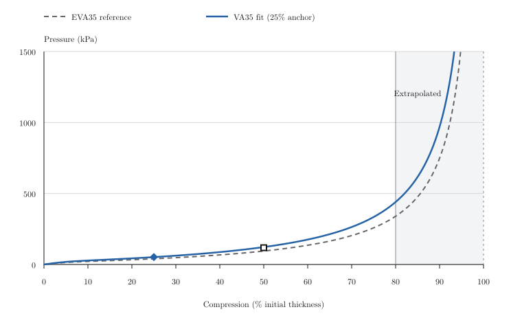

The prediction is about 4% above the unused supplier value, supporting pressure growth between these points for this grade. Matching density does not establish identical foams, and the supplier sheet does not state test speed. The final curve uses both values to estimate scale and skew; a third withheld measurement would be needed for an independent check.

### Impact curve

The slow supplier observations determine $\hat{\beta}_0$ and $\hat{\beta}_1$. The same multiplier is applied to the fast study curve:

$$
\begin{aligned}
\sigma^{\mathrm{SLOW}}(\varepsilon) &= e^{\hat{\beta}_0+\hat{\beta}_1\varepsilon}\times s^{\mathrm{SLOW}}(\varepsilon)\\
\sigma^{\mathrm{FAST}}(\varepsilon) &= e^{\hat{\beta}_0+\hat{\beta}_1\varepsilon}\times s^{\mathrm{FAST}}(\varepsilon)
\end{aligned}
$$

This preserves the study's fast-to-slow pressure ratio before the tail. The fast curve will usually lie above the supplier points because it represents greater resistance during quick loading.

### High-compression extrapolation

As a foam's internal spaces close, resistance rises sharply through densification. Supplier points usually end at 50% compression for EVA or 65% for PU and latex; the source studies extend to about [80% for EVA](https://pmc.ncbi.nlm.nih.gov/articles/PMC10707728/) and [70% for PU and latex](https://pure.psu.edu/en/publications/modeling-of-compression-curves-of-flexible-polyurethane-foam-with/). Beyond the study range, an unmeasured tail rises toward an estimated compression limit.

If $\rho^{\mathrm{FOAM}}$ and $\rho^{\mathrm{SOLID}}$ are the foam and solid-material densities in $\mathrm{kg/m^3}$, the limiting strain is

$$
\varepsilon^{\mathrm{CAP}}
=1-\frac{\rho^{\mathrm{FOAM}}}{\rho^{\mathrm{SOLID}}}
$$

| Family | Material density      | Basis                                                          |
| ------ | --------------------------- | -------------------------------------------------------------- |
| PU     | $1{,}200~\mathrm{kg/m^3}$   | Value used by Alzoubi et al., Section 5.3                      |
| Latex  | $920~\mathrm{kg/m^3}$       | Assumed value                                                  |
| EVA    | $950~\mathrm{kg/m^3}$       | Borrowed from other EVA formulations; assumed for these grades |

For EVA75 at $75~\mathrm{kg/m^3}$, the estimated limit is about 92.1% compression. This represents closure of the starting pore volume under the model assumptions, not measured failure or onset of densification.

The tail normally begins at $\varepsilon^{\mathrm{FIT}}=0.70$ for PU and latex or 0.80 for EVA. If the limit is too close, it begins earlier to leave 0.04 strain before the limit:

$$
\begin{aligned}
\varepsilon^{\mathrm{JOIN}} &= \min\left[\varepsilon^{\mathrm{FIT}},\varepsilon^{\mathrm{CAP}}-0.04\right]\\
L &= \varepsilon^{\mathrm{CAP}}-\varepsilon^{\mathrm{JOIN}}
\end{aligned}
$$

The margin is a numerical choice without measured physical meaning. Pressure and slope at the join are calculated after scale and skew:

$$
\begin{aligned}
p^{\mathrm{JOIN}} &= e^{\hat{\beta}_0+\hat{\beta}_1\varepsilon^{\mathrm{JOIN}}}\times s(\varepsilon^{\mathrm{JOIN}})\\
k^{\mathrm{JOIN}} &= e^{\hat{\beta}_0+\hat{\beta}_1\varepsilon^{\mathrm{JOIN}}}\times
\left[
\frac{ds(\varepsilon)}{d\varepsilon}+\hat{\beta}_1\times s(\varepsilon)
\right]_{\varepsilon=\varepsilon^{\mathrm{JOIN}}}
\end{aligned}
$$

Both curves require $k^{\mathrm{JOIN}}>0$. With $n^{\mathrm{TAIL}}=2$, pressure above the join is

$$
\sigma(\varepsilon)=p^{\mathrm{JOIN}}
+\frac{k^{\mathrm{JOIN}}L}{n^{\mathrm{TAIL}}}
\left[
\left(\frac{L}{\varepsilon^{\mathrm{CAP}}-\varepsilon}\right)^{n^{\mathrm{TAIL}}}-1
\right]
$$

The expression matches pressure and slope at the join and rises without bound near the limit. Any layer that reaches this unmeasured tail can make peak force and remaining thickness sensitive to the assumption. Pressure lookup ends at $1~\mathrm{GPa}$ or an earlier component-table endpoint; if the striker is still moving, the result is incomplete.

## Parameters for the worked example

### The punch

The reference represents a forceful punch by an adult without substantial punching training. [Adamec et al.](https://epub.ub.uni-muenchen.de/76042/1/76042.pdf) studied 50 adults and selected each person's highest-impulse attempt from three. Their dominant-fist group means provide a striking mass of 2.597 kg and speed of 7.7 m/s. Calculating from those separate means gives about 77 J.

### The dome striker

The dome follows [SATRA's hand-protector test](https://www.satra.com/spotlight/article.php?id=423): an 80 mm wide face with a 100 mm curvature radius.

### Hand and wrist give

A linear spring connects the effective mass to the rigid dome. Its assumed stiffness is $1~\mathrm{kN/mm}$, giving 1 mm of displacement per kilonewton. This unmeasured input should be varied when testing whether comparisons depend on hand and wrist give.

### The padded target

The target follows [Perkins et al.](https://www.scirp.org/pdf/wjet_2018072715333666.pdf), who used 25 and 50 mm EVA75 pads. The worked example uses 50 mm. The [Ultralon EVA75 sheet](https://www.ubuild.co.nz/wp-content/uploads/2022/10/properties-of-low-density-pe-eva-foams-feb-2022.pdf) lists 42-68 kPa at 25% compression and density from $68$ to $82~\mathrm{kg/m^3}$. The model chooses the midpoints, 55 kPa and $75~\mathrm{kg/m^3}$. This profile only approximates the study's target; its relevance to that mat or a human body requires validation.

### Parameter values

| Parameter | Value | Basis |
| --- | ---: | --- |
| $m$: striking mass | $2.597~\mathrm{kg}$ | Dominant-fist mean in [Adamec et al., table 2](https://epub.ub.uni-muenchen.de/76042/1/76042.pdf) |
| $v_0$: incoming speed | $7.7~\mathrm{m/s}$ | Separate mean from [Adamec et al.](https://epub.ub.uni-muenchen.de/76042/1/76042.pdf) |
| $R$: dome curvature radius | $100~\mathrm{mm}$ | [SATRA striker geometry](https://www.satra.com/spotlight/article.php?id=423) |
| $a$: maximum footprint radius | $40~\mathrm{mm}$ | Half the $80~\mathrm{mm}$ face diameter |
| $k_h$: hand-spring stiffness | $1~\mathrm{kN/mm}$ | Assumed |
| $\sigma^{\mathrm{TARGET}}(\varepsilon)$: target-foam pressure curve | EVA75 profile | EVA-family curve fitted to one pressure value |
| $h^{\mathrm{TARGET}}$: target thickness | $50~\mathrm{mm}$ | Condition in [Perkins et al.](https://www.scirp.org/pdf/wjet_2018072715333666.pdf) |
| $\rho^{\mathrm{TARGET}}$: target density | $75~\mathrm{kg/m^3}$ | Midpoint of the Ultralon range |
| $p_{25}^{\mathrm{TARGET}}$: target pressure at 25% compression | $55~\mathrm{kPa}$ | Midpoint of the Ultralon range |

Glove and target foams use the same compression equations. Glove grades and layer thicknesses vary, while the reference family, fast-loading assumptions, and tail rule stay fixed.

### Dome contact

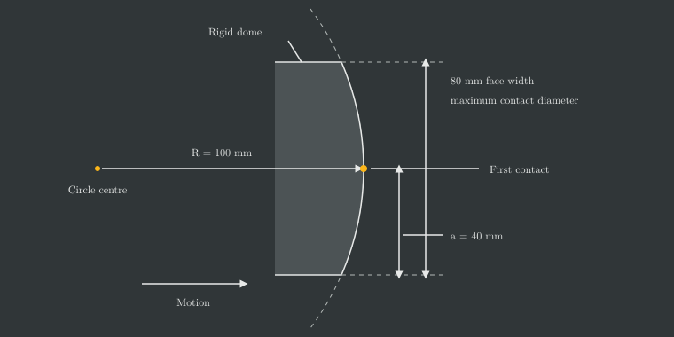

With these dimensions, $b(a)\approx8.35~\mathrm{mm}$. At that central advance the entire face is in contact and the footprint stops growing.

## Reported outputs and comparison metrics

Stacks are compared under the same punch, dome, target, and hand spring. Force-time and force-compression curves remain alongside summary measures because similar summaries can conceal different histories. Endpoint measures cover loading from first contact to stopping time $t^{\mathrm{END}}$. These measures cannot establish perceived "poppy" or "pillowy" feel because rebound is outside the model.

### Peak force

Peak force $F_{\max}$, in N, is

$$
F_{\max}=\max_{0\leq t\leq t^{\mathrm{END}}}\left[F(t)\right]
$$

It records the greatest load without describing how quickly that load developed.

### Force at 5 ms

With $t_5=0.005~\mathrm{s}$, early force $F_5$, in N, is

$$
F_5=F(t_5)
$$

Under the same punch conditions, a lower value indicates a softer early response and a higher value a firmer one. The metric is unavailable if loading ends before 5 ms.

### 10%-to-90% loading rate

Times $t_{10}$ and $t_{90}$ are the first times satisfying

$$
\begin{aligned}
F(t_{10}) &= 0.1F_{\max}\\
F(t_{90}) &= 0.9F_{\max}
\end{aligned}
$$

The average rate through the middle 80% of the rise is

$$
\text{loading rate}_{10-90}=\frac{0.8F_{\max}}{t_{90}-t_{10}}
$$

At the same peak force, a higher value means faster buildup. Peak force and loading rate must be interpreted together.

### Peak loading rate over 0.5 ms

For $\Delta t=0.0005~\mathrm{s}$, the largest force increase over any complete window is

$$
\text{loading rate}_{0.5~\mathrm{ms}}
=\max_{0\leq t\leq t^{\mathrm{END}}-\Delta t}
\left[\frac{F(t+\Delta t)-F(t)}{\Delta t}\right]
$$

[Perkins et al., pp. 613-617](https://www.scirp.org/pdf/wjet_2018072715333666.pdf) used the same duration on measured impacts, though their signals included oscillations absent here.

### Maximum glove compression at the centre

Central shortening of layer $i$ is

$$
q_i(t)=h_i\varepsilon_i\left[p(0;t)\right]
$$

Adding glove layers gives

$$
\begin{aligned}
q^{\mathrm{GLOVE}}(t) &= \sum_{i\in\mathrm{glove}}q_i(t)\\
q^{\mathrm{GLOVE}}_{\max} &= \max_{0\leq t\leq t^{\mathrm{END}}}\left[q^{\mathrm{GLOVE}}(t)\right]
\end{aligned}
$$

The result is reported in mm and as a percentage of starting thickness. A higher percentage means more travel was used and must be read with the force needed to reach it. [Chadli et al.](https://www.sciencedirect.com/science/article/abs/pii/S0263224118306316) found that similar glove compression could accompany different damping, supporting this paired interpretation.

### Layer compression and remaining thickness at the centre

Layer shortening and remaining thickness identify which layers enter the steep region of their curves. Minimum central thickness is

$$
\text{min central thickness}_i
=h_i-q_i\left(t^{\mathrm{END}}\right)
$$

The value must be interpreted against the layer's starting thickness and compression curve.

### Compression work by component

For foam layer $i$, work $U_i(t)$, in J, is

$$
U_i(t)=h_i\int_{A\left[q(t)\right]}
\left[\int_0^{\varepsilon_i[p(r;t)]}\sigma_i(\xi)~\mathrm{d}\xi\right]
\mathrm{d}A
$$

The inner integral is work per starting volume; thickness and area convert it to total layer work. For component $j$,

$$
\begin{aligned}
\text{component work}_j &= U_j\left(t^{\mathrm{END}}\right)\\
\text{work share}_j &= 100~\frac{U_j\left(t^{\mathrm{END}}\right)}{E_0}
\end{aligned}
$$

With a fixed target and no further push, the shares sum to 100% when the striker stops. The split depends on the selected target and spring stiffness. Loading work includes recoverable and dissipated energy; permanent absorption requires unloading behaviour.

## Model scope and limitations

### What it can compare

The model compares foam grades and layer thicknesses under the same impact and describes force buildup, compression, and division of stopping work. Accuracy for real gloves has not been established.

### What it leaves out

Layer order has no effect. Every foam uses a borrowed fast-loading curve fixed as compression rate changes, and the high-compression tail is extrapolated. The dome is rigid and moves in one direction against a fixed plate; sideways deformation, foam and cover mass, local hand deformation, and off-centre contact are absent. Hand and wrist give is a massless linear spring with assumed stiffness. The calculation supplies no rebound, damage, fatigue, or repeated-impact response.

# Simulation analysis

## Simulation design

The design question was whether the same glove thickness and foam-weight budget could provide similar peak-force protection with either a soft or responsive force curve. A 50 mm stack gave a plausible reference depth for a well-padded training glove, based on published and commercial examples around 35-50 mm. Fixing thickness held the available travel constant for the first comparison.

The impact used a 2.597 kg striking mass at 7.7 m/s, about 77 J, against 50 mm CutFoam EVA75. Holding the punch, target, dome, hand spring, and material assumptions constant isolated the foam construction. The analysis covered 2,206,920 complete stacks, each containing four distinct grades within 50 mm.

Final recipes were compared inside a $2.50\mathbin{+/-}0.05$ g standardized foam-sample range. This represented a hypothetical glove-weight class and tested whether the same material budget and similar peak-force protection could produce two response curves. After selection, impact energy was varied and every layer was scaled proportionally to test the designs beyond the original impact and thickness.

The layer labels identify the role assigned during enumeration, so a winning outer grade supports including that foam rather than placing it specifically on the outside.

| Layer        | Materials             | Thickness                     |
| ------------ | --------------------- | ----------------------------- |
| Outer        | PU, HR, or latex      | 5, 10, 15, 20, or 25 mm       |
| Main cushion | PU, HR, EVA, or latex | Remaining thickness, 15-39 mm |
| Support      | EVA                   | 3, 4, or 5 mm                 |
| Comfort      | PU or HR              | 3, 4, or 5 mm                 |

## Effects of foam family by layer

To understand what each layer contributed, we grouped stacks by the material family used in that layer. Each result averages over every valid combination of the other three layers, so it shows a broad design tendency rather than the performance of a specific recipe.

HR in the outer layer reduced mean peak force and compression while producing a firmer early response than PU. PU suited a softer start. Latex modestly improved cushioning relative to PU but added weight and remained behind HR. In the main cushion, HR produced the lowest mean peak force and compression while developing resistance earlier than conventional PU. EVA fell between HR and PU on those outcomes but had the greatest mean weight, and latex offered no clear advantage over HR or EVA.

Increasing the support layer's EVA firmness produced diminishing cushioning gains. Moving from soft to medium EVA captured most of the reduction in peak force and compression; firm EVA added weight with little further change and no meaningful rise in early resistance. Comfort-layer family was a smaller adjustment: HR gave slightly lower mean peak force and compression and slightly greater early resistance than PU at similar weight.

Values are mean (SD).

### Outer

| Material | Peak force (kN) | Compr. (%) | Force 5 ms (kN) | Sample weight (g) |
| --- | ---: | ---: | ---: | ---: |
| PU | 4.90 (1.01) | 88.0 (10.3) | 0.34 (0.13) | 2.18 (1.26) |
| HR | 3.94 (0.69) | 78.5 (13.3) | 0.47 (0.18) | 2.35 (1.25) |
| Latex | 4.67 (0.93) | 85.6 (10.4) | 0.39 (0.13) | 2.88 (1.28) |

### Main cushion

| Material | Peak force (kN) | Compr. (%) | Force 5 ms (kN) | Sample weight (g) |
| --- | ---: | ---: | ---: | ---: |
| PU | 5.27 (0.85) | 91.8 (5.7) | 0.28 (0.08) | 1.77 (0.42) |
| HR | 3.64 (0.51) | 72.8 (12.9) | 0.54 (0.15) | 2.09 (0.39) |
| EVA | 4.10 (0.63) | 82.6 (10.9) | 0.44 (0.14) | 3.47 (2.12) |
| Latex | 4.77 (0.66) | 87.6 (5.9) | 0.38 (0.07) | 3.08 (0.54) |

### Support

| Material | Peak force (kN) | Compr. (%) | Force 5 ms (kN) | Sample weight (g) |
| --- | ---: | ---: | ---: | ---: |
| Soft EVA | 4.66 (1.06) | 85.6 (12.0) | 0.38 (0.15) | 2.05 (1.29) |
| Medium EVA | 4.53 (0.99) | 84.6 (12.2) | 0.39 (0.16) | 2.35 (1.25) |
| Firm EVA | 4.50 (0.92) | 83.3 (12.2) | 0.39 (0.17) | 2.70 (1.08) |

### Comfort

| Material | Peak force (kN) | Compr. (%) | Force 5 ms (kN) | Sample weight (g) |
| --- | ---: | ---: | ---: | ---: |
| PU | 4.67 (1.04) | 85.2 (11.9) | 0.37 (0.15) | 2.23 (1.26) |
| HR | 4.50 (0.99) | 84.5 (12.3) | 0.40 (0.16) | 2.30 (1.27) |

## Early impact response

Force at 5 ms was used to distinguish the initial buildup of resistance from peak force. Lower values represented a gentler initial response, while higher values represented a firmer and more immediate response. We set 0.50 and 0.70 kN as design cutoffs for clearly separated soft and responsive profiles, leaving the interval between them as neutral. The same bands were then applied to every stack.

| Response   | Force at 5 ms (kN) |
| :--------- | :----------------- |
| Soft       | Below 0.50         |
| Neutral    | 0.50 to below 0.70 |
| Responsive | 0.70 or higher     |

With the bands fixed, the distribution by main-cushion family showed how that layer changed both the typical early response and the range available for tuning it.

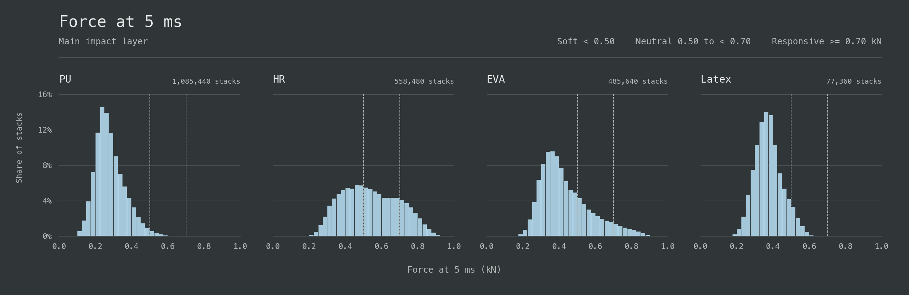

The main cushion was the primary determinant of protection and response. PU produced soft gloves in 98.9% of its stacks and latex in 93.0%; neither produced a responsive glove. EVA and HR spanned broader, firmer distributions. EVA placed 20.9% of its stacks in neutral and 5.9% in responsive, while HR placed 37.8% in neutral and 18.3% in responsive.

HR provided the stronger base for tuning feel. Compared with EVA, it had lower mean peak force, 3.64 versus 4.10 kN, and lower mean sample weight, 2.09 versus 3.47 g. PU's low early force came with the highest mean peak force and compression, meaning it felt soft because it yielded extensively. Latex showed the same problem without PU's weight advantage.

## Performance by sample weight

Each 0.5 g band compared stacks of similar weight. In the figures, coloured regions show outcome quintiles and the blue line marks the lowest peak force or compression; on the response graph it marks the lowest early force.

Peak-force performance was strongest around 1.5-3 g. The lightest stacks lacked enough resistance to control the punch. Above 3 g, denser foams increased sample weight within the fixed 50 mm depth, but peak force began to rise. Incoming energy stayed fixed, so the extra material weight did not add protection in this simulation.

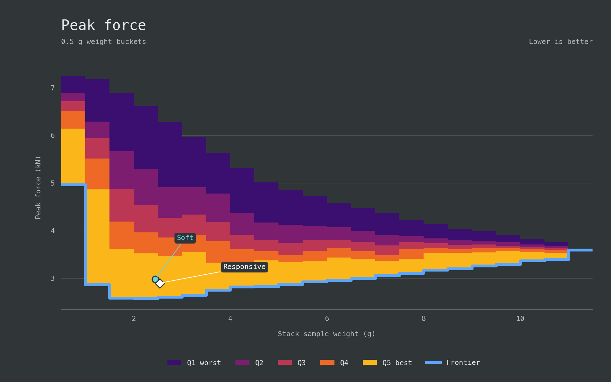

The compression frontier changed abruptly at 3.5 g. Its minimum rose from 38.7% in the 3.0-3.5 g band to 52.5% in the 3.5-4.0 g band, while the peak-force frontier moved from 2.65 to 2.75 kN. Below 3.5 g, long, firm HR main cushions defined the low-compression edge. Entering the next weight band at the same total thickness required denser EVA in the main cushion, and minimum compression rose sharply.

Peak force records the greatest transmitted load, while compression shows how close the stack came to exhausting its travel. A useful stack had to limit peak force without compressing nearly flat.

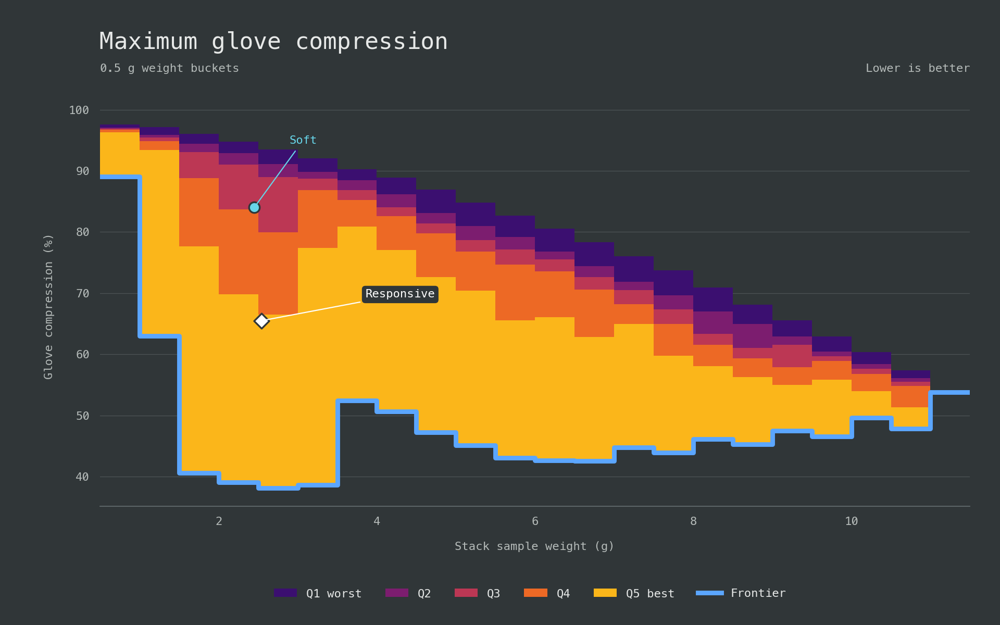

Weight did not determine early response. Around 2.5 g, stacks extended from soft through responsive, with composition and especially the main cushion setting their position.

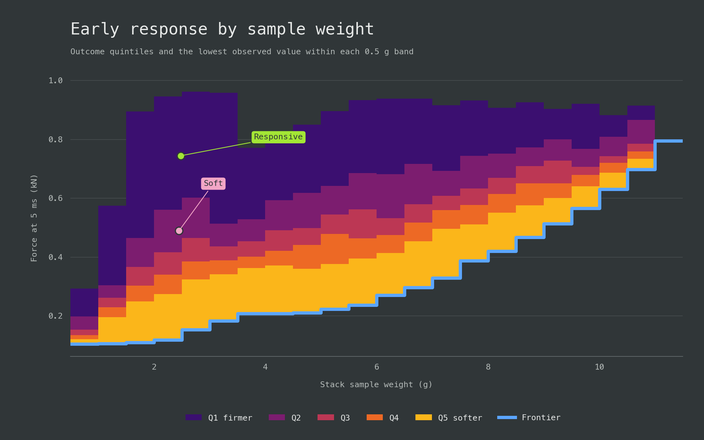

## Relationship between peak force and early response

Peak force was compared with force at 5 ms across all 2,206,920 stacks before selecting recipes. The comparison showed how far early response could change while peak-force protection stayed near its best value.

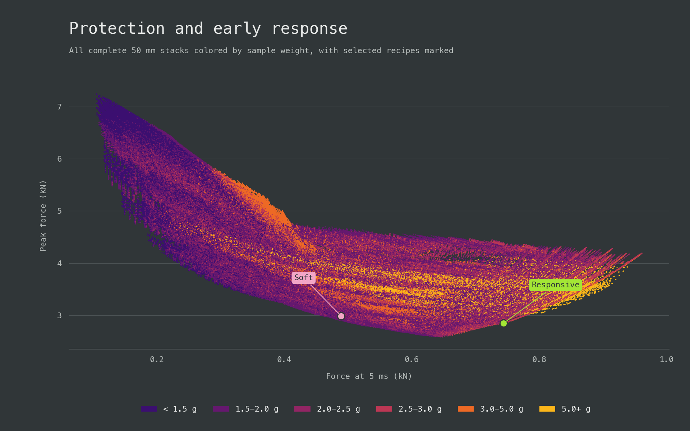

The lowest achievable peak force formed a U-shaped frontier. Its minimum, 2.58 kN, occurred at 0.648 kN after 5 ms in the neutral band. Low peak force remained possible from upper-soft through responsive behaviour, leaving room to tune the initial response around the protective region.

Very soft stacks gave up too much resistance early. Below 0.2 kN at 5 ms, even the best stack reached 4.33 kN peak force. Protection improved as early response approached neutral, then worsened again beyond that band. Above 0.85 kN at 5 ms, no stack remained below 3.29 kN peak force; above 0.9 kN, the minimum was 3.52 kN.

Near the 2.5 g target, stacks below the 3.026 kN protection ceiling covered both response profiles needed for selection. Soft candidates clustered near the upper edge of their band at 0.475-0.500 kN, while responsive candidates covered 0.700-0.783 kN.

## Selected soft and responsive stack architectures

Two recipes were selected to provide strong protection with different response profiles at the same 50 mm thickness and foam-weight budget. A standardized sample weight near 2.50 g represented one hypothetical glove-weight class and lay near the middle of the 1.5-3 g range where peak-force results were strongest.

Selection retained the 72,202 stacks within $2.50\mathbin{+/-}0.05$ g. Each outcome received a 0-100 percentile score based on the share of these stacks it outperformed, with half credit for ties.

| Metric              | Weight |
| ------------------- | -----: |
| Peak force          |    60% |
| Maximum compression |    20% |
| Force at 5 ms       |    20% |

Lower values scored higher. Force at 5 ms also acted as a response constraint: below 0.5 kN for the soft recipe and at least 0.7 kN for the responsive recipe. Within each group, lower early force scored higher, so responsive candidates gained nothing from exceeding the threshold. Candidates also had to remain below 3.026 kN peak force, the result of the original 50 mm soft recipe. The top-scoring 10% of each group, including ties, defined the recipe families, and the highest-scoring member supplied each response-curve example.

### Soft: compliant PU with a soft HR core

#### Top-scoring soft recipe family

The high-scoring soft recipes concentrated compliance in 10 mm of conventional PU and a thin Super Soft PU comfort layer. A 33-34 mm HR Soft core occupied most of the thickness and developed resistance later in the impact. Changing the outer or support grade had little effect compared with the division between a small compliant portion and a much larger HR core.

The family achieved a soft initial response while holding mean peak force near 3.0 kN. Mean compression reached 84.3%, leaving little reserve at the reference impact.

| Metric             |  Mean |
| ------------------ | ----: |
| Sample weight (g)  |  2.47 |
| Peak force (kN)    |  3.00 |
| Force at 5 ms (kN) | 0.484 |
| Compression (%)    |  84.3 |

#### Selected soft recipe

The highest-scoring stack used for the response curves weighed 2.452 g.

| Layer        | Foam                    | Thickness |
| ------------ | ----------------------- | --------- |
| Outer        | Foam Factory Lux-HQ     | 10 mm     |
| Main cushion | FoamOnline HR Soft      | 34 mm     |
| Support      | CutFoam EVA240          | 3 mm      |
| Comfort      | Foam Factory Super Soft | 3 mm      |

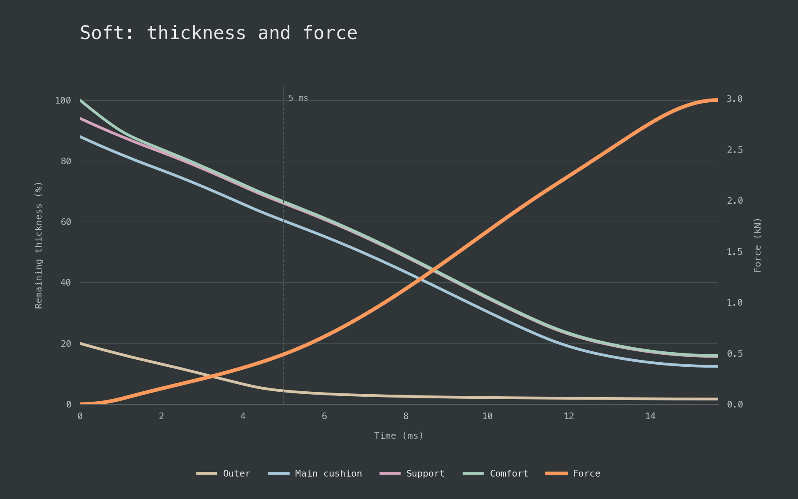

At 5 ms, the compliant outer and comfort layers had used most of their travel while the HR core retained most of its thickness. Over the complete loading phase, the core absorbed most of the glove's compression work. The thin PU layers set the soft initial response and the HR core supplied the later support.

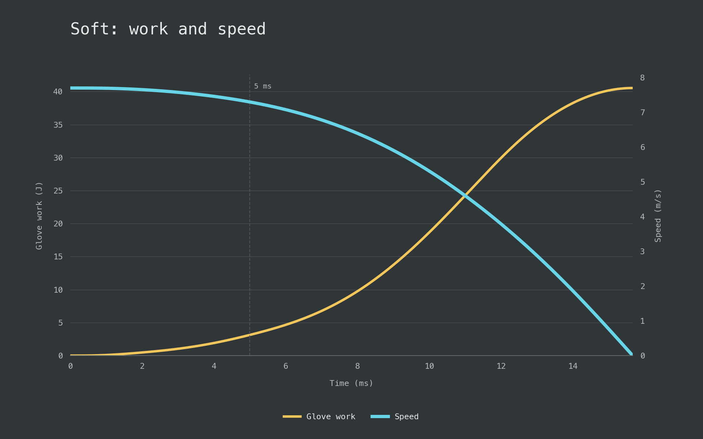

### Responsive: firmer HR cushioning throughout

#### Top-scoring responsive recipe family

The responsive recipes developed resistance earlier and improved both peak-force and compression results. At essentially the same sample weight, mean force at 5 ms rose from 0.484 to 0.738 kN, mean peak force fell from 3.00 to 2.87 kN, and mean compression fell from 84.3% to 67.3%.

Every leading stack used HR for the outer and main cushion, together occupying about 43 mm. The long cushion converged on moderate HR grades with modeled pressure around 229-233 kPa at 25% compression. The family retained 32.7% of its starting thickness at maximum load, more than twice the soft family's 15.7%.

| Metric             |  Mean |
| ------------------ | ----: |
| Sample weight (g)  |  2.51 |
| Peak force (kN)    |  2.87 |
| Force at 5 ms (kN) | 0.738 |
| Compression (%)    |  67.3 |

#### Selected responsive recipe

The selected stack weighed 2.482 g.

| Layer        | Foam                                     | Thickness |
| ------------ | ---------------------------------------- | --------- |
| Outer        | FoamOnline High Resilience - Medium Soft | 25 mm     |
| Main cushion | CutFoam HR36-160                         | 19 mm     |
| Support      | Aortha EVA A50                           | 3 mm      |
| Comfort      | FoamOnline HR Very Soft                  | 3 mm      |

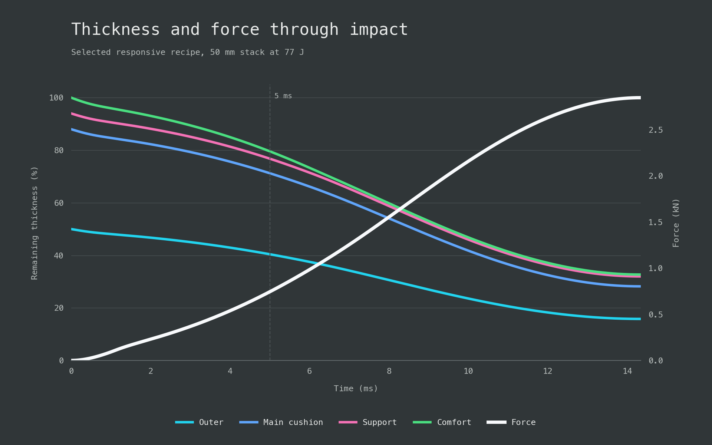

At 5 ms, both large HR layers retained about 81% of their starting thickness while force had reached 0.744 kN. Together they absorbed 49.5% of the incoming energy over the full punch. Earlier resistance left 32.7% of the stack's starting thickness at peak force.

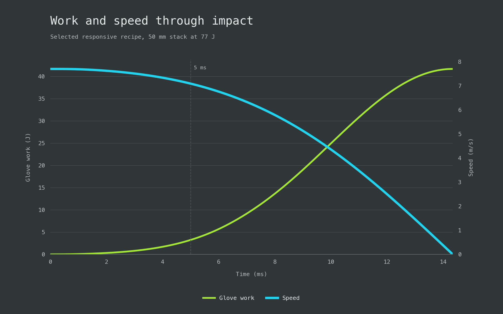

### Design takeaway

The simulation produced soft and responsive 50 mm recipe families in the same sample-weight class and below the same peak-force ceiling. Their mean forces at 5 ms, 0.484 and 0.738 kN, separated the response profiles while weight stayed nearly fixed.

Architecture created the difference. The soft family placed 13 mm of compliant PU around a thick HR core, delaying resistance and using more travel. The responsive family used HR through about 43 mm, developing resistance earlier across most of the stack. Its mean peak force was 2.87 kN with 67.3% compression, compared with 3.00 kN and 84.3% for the soft family. Changing score weights altered some grades and thicknesses but preserved these two architectures.

## Sensitivity to thickness and punch energy

The sensitivity analysis tested how total foam thickness and punch energy changed each recipe's protection and response. Total thickness varied from 25 to 60 mm while layer proportions were held constant, and punch energy varied from 60 to 120 J.

### Protection depended on the operating range

The soft construction delayed force buildup by using compression travel early. At higher energy it entered the steep high-compression region, effectively bottoming out even though it did not reach a rigid stop. Load arrived later, but the remaining travel could no longer prevent a sharp peak.

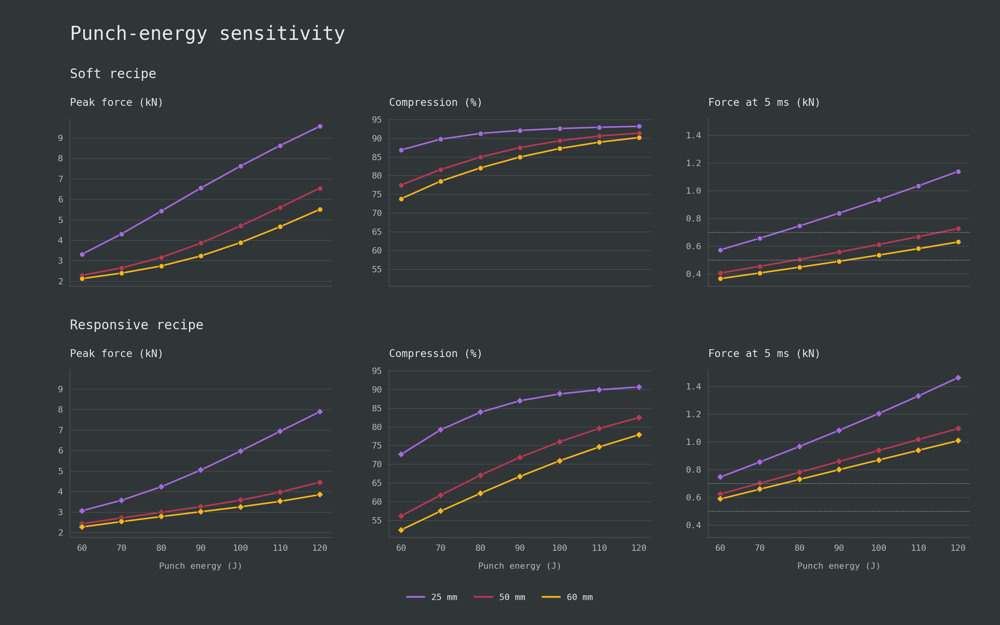

At 50 mm and 60 J, Soft had the gentler response and slightly lower peak force: 0.406 versus 0.624 kN at 5 ms and 2.29 versus 2.42 kN peak force. Responsive retained much more thickness, with 56.2% compression against 77.5%, but that reserve had not yet improved peak protection.

The protection crossover moved with energy and thickness. At 60 J, Responsive had lower peak force only at 25-30 mm. At 70 J this extended through 45 mm, at 80 J through 55 mm, and from 90 J onward Responsive was better at every tested thickness. Extra thickness delayed the soft design's disadvantage but did not remove it.

At 120 J, a 35 mm Responsive stack reached 6.16 kN peak force and 88.3% compression. The 50 mm Soft stack reached 6.54 kN and 91.4% while weighing 2.45 g against 1.78 g. The thinner Responsive stack improved protection with 27% less sample weight, though its force at 5 ms was 1.28 kN rather than 0.726 kN.

Added thickness created different reserves. From 25 to 60 mm at 120 J, Soft compression changed only from 93.2% to 90.2%, while Responsive improved from 90.7% to 77.9%. At 50 mm, Soft's last 10 J added about 2.6 times as much peak force as its first 10 J, showing how sharply the response rose once its compliant layers had nearly exhausted their travel.

### Each recipe had a response operating range

Early-force shaping remained useful only while the stack could manage the rest of the impact.

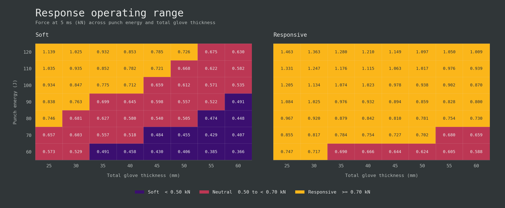

Soft remained relatively softer at every matched condition but did not remain in the soft band. At 50 mm it was soft at 60-70 J, neutral at 80-110 J, and responsive at 120 J; no tested thickness kept it soft at 100-120 J. Responsive was neutral at 60 J and crossed into its responsive band at 70 J. A recipe could move from one response band to another as impact energy increased.

### The design has to match the use case

Soft suited the lower-energy condition when a gentle initial response mattered. Responsive was firmer and initially carried reserve that was not yet needed, producing a small peak-force penalty in thicker low-energy configurations. As energy rose, the soft design consumed too much travel and its peak force increased rapidly, while Responsive converted earlier resistance into useful reserve and better high-energy protection.

The preferred recipe depends on the intended impact range, thickness limit, weight budget, and response. The high-energy comparison also depends on the assumed high-compression curves: at 50 mm and 120 J, both cores exceeded their reference-fit range. Measurements are needed before the modeled separation can be treated as a verified impact limit.

# Conclusion

Foam-family labels and isolated firmness values did not predict stack performance. The useful behaviour of each grade came from the shape of its compression curve, the thickness assigned to it, and the surrounding architecture. Conventional PU supplied initial compliance but consumed travel quickly when used extensively. HR PU provided the strongest main-cushion performance in this comparison, combining earlier support with lower peak force and greater compression reserve. EVA was most useful as a thin support layer; increasing firmness brought diminishing cushioning gains, while using dense EVA as the main cushion added weight without matching the best HR results. Latex added weight and showed no clear advantage over the tested PU, HR, and EVA options.

The soft and responsive families exposed the main design tradeoff. A small amount of compliant PU around a thick soft-HR core produced a gentler start near the 77 J selection condition, but it used most of its available travel. Extending HR through most of the stack developed force earlier, reduced peak force, and retained substantially more thickness. At lower energy the soft architecture could match or slightly improve peak-force protection; as energy rose, its limited reserve caused peak force to climb rapidly and the responsive architecture became stronger.

Stack selection must therefore be tied to the intended punch range, available thickness, weight budget, and desired early response. A recipe described as soft or responsive at one condition may move into another response band when energy or thickness changes. Our model made these comparisons possible despite incomplete commercial foam data by connecting estimated material curves with stack construction, glove geometry, and impact conditions. Its purpose is to identify promising architectures and the conditions under which they work, so physical prototyping can focus on the strongest candidates. Testing the selected grades and complete stacks is still needed to verify the modeled force histories, compression reserve, and perceived feel in real gloves. The simulation exposes these choices when comparable foam data are scarce, but the fast-loading curves and high-compression tails remain estimates. 

# References and source notes

## Standards and competition rules

[SATRA, PPE for use in martial arts](https://www.satra.com/spotlight/article.php?id=423) summarizes EN 13277 controlled impacts and transmitted-force limits for some martial-arts hand protectors, including the 3 J and 10 J benchmarks used for wearer protection.

[EN 13277-7:2009 preview, hand and foot protectors](https://cdn.standards.iteh.ai/samples/26354/0e49f762fd014431939bb6888166baf2/SIST-EN-13277-7-2009.pdf) defines the scope, classes, coverage, restraint, and impact-performance framework for martial-arts hand protectors, including boxing. The preview excludes performance for the opponent; certification work requires the complete controlled standard.

[World Boxing Competition Rules, November 2024](https://worldboxing.org/wp-content/uploads/2024/11/World-Boxing-Competition-Rules-Nov-2024-Approved.pdf) specifies glove weight, minimum padding share, condition, closure, materials, and thumb attachment. Padding curves and layer recipes fall outside these eligibility requirements.

[IBA, Guidelines for the Approval of Boxing Equipment](https://www.iba.sport/wp-content/uploads/2025/09/IBA_Equipment_Guidelines_FV.pdf) describes laboratory testing, field verification, approval, and periodic control at a high level, separating equipment approval from the material data needed to model a foam stack.

## Test methods and supplier data

[ISO 2439:2008, indentation hardness of flexible cellular materials](https://www.iso.org/standard/42717.html) defines indentation-hardness methods at 25%, 40%, and 65% indentation and includes hysteresis-related information. It places IFD, ILD, and support factor within a broader compression response.

[ASTM D3574, flexible urethane foam test methods](https://store.astm.org/d3574-25.html) collects tests used for flexible PU research, quality control, and specification and helps interpret the test names and conditions on supplier sheets.

[ISO 3386-1:2025, compression stress-strain characteristics of low-density flexible cellular materials](https://www.iso.org/standard/89164.html) defines a method for measuring compression stress-strain response in low-density flexible cellular materials.

[Polyurethane Foam Association, foam performance](https://pfa.org/foam-performance/) defines density, 25% IFD, support factor, and flex fatigue in supplier terminology.

[Polyurethane Foam Association, foam test methods](https://pfa.org/foam-test-methods/) maps common PU properties to ASTM and other test methods.

[Polyurethane Foam Association, laboratory testing of flexible polyurethane foam](https://pfa.org/wp-content/uploads/2022/05/InTouchv4.2new.pdf) explains IFD and CFD procedures, the nominal 50 in² indentation area, and specimen-thickness effects used when converting force to an average-pressure anchor.

## Foam compression studies

[Alzoubi, Al-Hallaj, and Abu-Ayyad (2014), modeling compression curves of flexible polyurethane foam](https://pure.psu.edu/en/publications/modeling-of-compression-curves-of-flexible-polyurethane-foam-with/) reports compression tests and fitted curves for several PU foams and one latex foam at stated densities, temperatures, strain rates, and compression ranges. Its equations supply the candidate PU and latex curve shapes.

[Wu et al. (2023), one-dimensional dynamic constitutive modeling of EVA foam](https://www.mdpi.com/2073-4360/15/23/4514) measures a $35~\mathrm{kg/m^3}$ EVA foam at several compression rates and develops a rate-dependent model separating a plateau response from trapped-air effects.

[Chen et al. (2024), mechanical behavior of closed-cell EVA foam under compression](https://www.mdpi.com/2073-4360/16/1/34) compares EVA foams across densities and compression rates, including energy absorption and densification.

## Punch and glove-impact studies

[Walilko, Viano, and Bir (2005), biomechanics of Olympic boxer punches](https://pubmed.ncbi.nlm.nih.gov/16183766/) reports hand speed, effective punch mass, force, energy transfer, and head response for straight punches delivered to a Hybrid III dummy. Its small sample supplies context for controlled-impact inputs.

[Adamec et al. (2021), biomechanical assessment of punching techniques](https://pubmed.ncbi.nlm.nih.gov/33057792/) compares mechanics across punching techniques and supplies the effective mass and speed used in the worked example. The values remain specific to the study apparatus and protocol.

[Perkins et al. (2018), prototype boxing gloves under two target-padding conditions](https://doi.org/10.4236/wjet.2018.63037) tests several gloves on a mechanical fist and shows that target padding changes measured peak force, loading rate, contact time, and relative glove performance.

[Girodet et al. (2009), damping characteristics of nine French boxing gloves](https://doi.org/10.1080/10255840903080885) compares 10, 12, and 14 oz gloves at 3, 10, and 20 J. Gloves with the same nominal weight produced different peak forces, with wider differences at higher energy.

[Chadli et al. (2018), quantification of boxing-glove damping](https://doi.org/10.1016/j.measurement.2018.07.036) compares six new and worn 10 oz gloves at 4, 18, and 44 J using whole-glove compression and damping measures. Its aggregate results do not identify the behaviour of individual layers.

[Amauger (2022), thesis chapter 7](https://theses.hal.science/tel-04105395) places a 1.3 kg steel sphere inside a glove, drops it onto a load cell, and records force and deformation to calibrate a simplified fist-glove model.

[Lee and McGill (2014), striking dynamics of boxing and MMA gloves](https://doi.org/10.18002/rama.v9i2.1175) measures peak force and loading rate through 10,000 repeated impacts. The one-glove-per-type comparison leaves general material and layer effects unresolved.

[Smith et al. (2000), development of a boxing dynamometer](https://pubmed.ncbi.nlm.nih.gov/10902679/) measures punch force in a boxing-specific apparatus and compares boxer groups. Its values belong to that dynamometer, protocol, and participant group.

[Buško et al. (2016), measuring punches and kicks with a modified punching bag](https://actabio.pwr.edu.pl/fcp/HGBUKOQtTKlQhbx08SlkTUARAUWRuHQwFDBoIVURNWHhQFVZpCFghUHcKVigEQUw/302/public/publikacje/v18-1-2016/7.pdf) reports the mass, diameter, and rigid-core padded construction of an instrumented bag. The moving-bag target uses its 41 kg mass and 0.42 m diameter.
